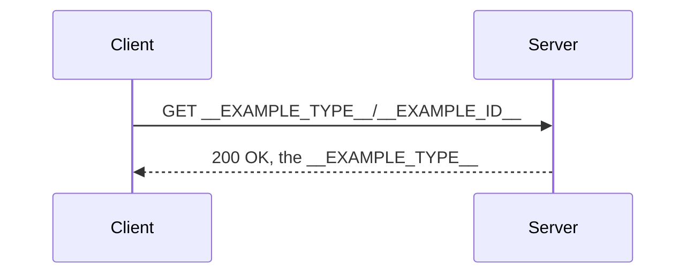

This page shows features of the IG Publisher that you can use in your own pages. Each section shows what to write, then what it produces. It works with any template. The profile and the example it uses — __PROFILE_NAME__ and __EXAMPLE_TYPE__/__EXAMPLE_ID__ — were picked from this IG when the page was added.

Keep what helps, delete the rest. To remove the page, delete `input/pagecontent/ig-features.md` and its entry under `menu:` in `sushi-config.yaml`.

### Links to resources

Three square brackets link to a resource by name or canonical URL, or to a FHIR type. The link text is the resource's title, and the link follows the resource if its page ever moves.

```
[[~[__PROFILE_NAME__]]] · [[~[__PROFILE_URL__]]] · [[~[Patient]]] · this IG's version: [[~[$ver]]]
```

[[[__PROFILE_NAME__]]] · [[[__PROFILE_URL__]]] · [[[Patient]]] · this IG's version: [[[$ver]]]

Plain Markdown links work too: to a page of this IG, and, through `site.data.fhir.path`, into the FHIR specification of the version this IG is built on.

```
[the profile](StructureDefinition-__PROFILE_ID__.html) · [Patient in the spec]({{site.data.fhir.path}}patient.html)
```

[the profile](StructureDefinition-__PROFILE_ID__.html) · [Patient in the spec]({{site.data.fhir.path}}patient.html)

### Data about the IG

Liquid variables give access to what the publisher knows about the IG, so a page never states a version that has gone stale.

```
{{site.data.fhir.ig.title}}, version {{site.data.fhir.ig.version}}, canonical {{site.data.fhir.canonical}}
```

{{site.data.fhir.ig.title}}, version {{site.data.fhir.ig.version}}, canonical {{site.data.fhir.canonical}}

### Conformance statements

Sentences with SHALL or SHOULD can be marked as conformance statements. The publisher numbers them, links them, and collects them in one table. Inline, put the statement between two section signs, with an id in front:

<p><code>A server §ex-1:**SHALL** reject an unknown code</code><code>§, and report it in an OperationOutcome.</code></p>

A server §ex-1:**SHALL** reject an unknown code§, and report it in an OperationOutcome.

For a statement spanning several paragraphs, put a paragraph that starts with two section signs before it — followed by `id:summary^title` — and a paragraph of just two section signs after it:

<p>Paragraph 1: <code>§</code><code>§ex-2:Search by identifier^Searching for a patient</code><br/>
Paragraph 2: <code>A client **SHOULD** search by identifier rather than by name.</code><br/>
Paragraph 3: <code>A server **SHALL** support the `identifier` search parameter.</code><br/>
Paragraph 4: <code>§</code><code>§</code></p>

This renders as

§§ex-2:Search by identifier^Searching for a patient

A client **SHOULD** search by identifier rather than by name.

A server **SHALL** support the `identifier` search parameter.

§§

The table of all statements in the IG goes wherever a paragraph consists of three section signs, and can only appear once per IG:

__CONFORMANCE_TABLE__

### Diagrams

Mermaid diagrams are written as a code block with the language `mermaid`. See the [Mermaid syntax](https://mermaid.js.org/intro/syntax-reference.html) for flowcharts, sequence diagrams and more.

~~~

~~~


### Parts of an example

An example can be shown in JSON or XML, whole or in part. `BASE:` picks an element with FHIRPath, `ELIDE:` replaces elements with `...`, and `EXCEPT:` keeps only the elements named.

```


```





### Generated views

Everything the publisher renders on the resource pages is also available as an include: tables of a profile, the narrative of an example, and many more. After a build, `temp/pages/_includes` lists them all.

```


```





### Lists of the IG's resources

Lists cover a whole kind of resource and stay current as resources are added. They contain only the list items, so the list itself is opened and closed around them.

```



```





### Note boxes

The base templates style a few kinds of boxes. A `div` needs `markdown="1"` for Markdown inside it to be rendered.

```
<div class="stu-note" markdown="1">
**Trial use:** this part may change based on feedback.
</div>
```

<div class="stu-note" markdown="1">
**Trial use:** this part may change based on feedback.
</div>

### Further reading

The [IG Guidance](https://build.fhir.org/ig/FHIR/ig-guidance/) describes these features and more: SQL queries over the IG's resources, UML and PlantUML diagrams, multi-language IGs, and the IG parameters.
